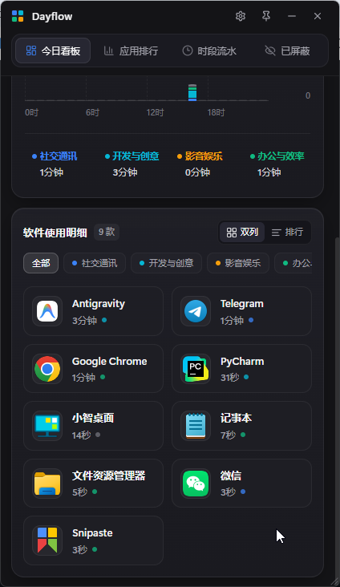
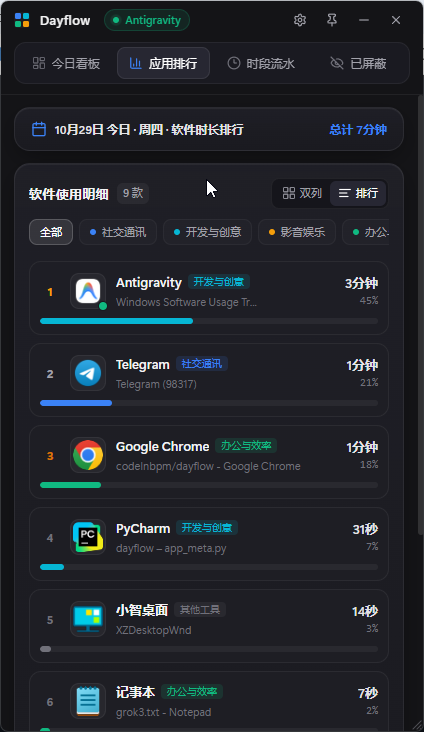
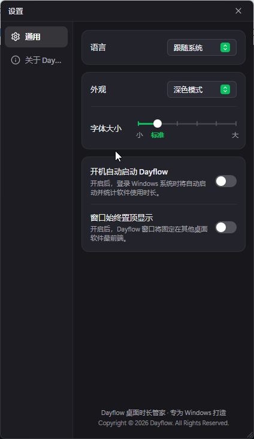

<div align="center">

# 📊 Dayflow — Windows 桌面时长管家

**轻量、原生质感、100% 本地隐私存储的 Windows 桌面应用使用时间追踪与可视化工具**  
*A Modern, Privacy-First Windows Desktop Screen Time Tracker & Visualizer*

[](https://github.com/codeInbpm/dayflow)
[](https://www.python.org/)
[](https://vuejs.org/)
[-003B57?style=flat-square&logo=sqlite&logoColor=white)](https://www.sqlite.org/)
[](https://github.com/codeInbpm/dayflow)

</div>

---

## ✨ 项目简介 (Introduction)

**Dayflow** 是一款专为 Windows 10/11 打造的桌面级「屏幕使用时间（Screen Time）」实时统计与可视化看板工具。它通过底层 Win32 API 实时感知当前前台活跃软件，自动提取应用程序高清真实图标与中文/英文名称，进行智能分类聚合，并以现代精致的卡片式 UI 呈现每日、每周、每月的使用分布与精确到秒的会话流水。

所有采集数据 **100% 保存在本地 SQLite 数据库** 中，永久留存、零云端上传、极低内存与 CPU 占用。

---

## 🖼️ 界面预览 (Screenshots)

| 📊 今日看板 & 双列磁贴视图 | 🏆 应用时长排行榜视图 | ⚙️ 通用设置中心 (多语言/主题/字号/自启) |
| :---: | :---: | :---: |
|  |  |  |

---

## 🚀 核心功能特性 (Key Features)

### 🌟 v1.0.1 重磅升级新特性 (What's New in v1.0.1)
- **💤 用户空闲/挂机离线智能检测（Idle Detection）**：底层 Win32 `GetLastInputInfo` 毫秒级感知，当键盘/鼠标超过 3 分钟无操作自动判定为离线挂机，立即自动封口当前软件会话并暂停计时；当您重新敲击键盘或移动鼠标时秒级自动恢复活跃，彻底告别锁屏或离开电脑时的“虚高”统计。
- **🌐 浏览器内标签页二级智能分类（网页细粒度分流）**：打破“整个浏览器都算同一分类”的传统痛点，智能捕获 Chrome、Edge、Firefox 等主流浏览器的窗口标签标题，精准分流：
  - **影音娱乐**：B站 (bilibili)、YouTube、爱奇艺、腾讯视频、网易云音乐、Twitch 等；
  - **开发与创意**：GitHub、GitLab、StackOverflow、ChatGPT、Claude、V2EX、LeetCode、Figma 等；
  - **办公与效率**：飞书、语雀、Notion、Google Docs、腾讯文档、Office 365 等；
  - **社交通讯**：微博、知乎、微信网页版、Twitter/X、Reddit、贴吧等。
- **🌱 连续专注久坐智能双模提醒（Health & Focus Guard）**：
  - **默认 30 分钟**（支持自定义设置 20/30/45/60/90 分钟，修改后永久存储在 SQLite 数据库中，**软件或系统重启依然牢牢保持修改值**）；
  - **智能双模触达**：Dayflow 窗口在可见前台时在应用内滑出微光关怀横幅；当处于**最小化、后台或贴边隐藏**时，自动触发 **Windows 系统原生通知与柔和水滴微音**，不常驻前台也能精准提醒；
  - **🎮 游戏与全屏演示免打扰（Game DND Guard）**：底层调用 `SHQueryUserNotificationState`，在《英雄联盟》等全屏游戏对局或全屏 PPT 演示期间自动暂缓提醒，绝不在打团时遮挡视线，待退出全屏后再温柔提示；
  - **离线清零恢复**：离开电脑超过 2 分钟时自动判定为健康休息，重置专注计时器。
- **⌨️ 全局快捷键唤出/隐藏（自定义快捷键）**：
  - 支持用户在【设置】中自由自定义全局呼出快捷键（如 `Alt+D`、`Ctrl+Shift+D`、`Alt+Space` 等），或一键选用推荐预设；
  - 基于 Windows 原生独立消息泵线程 `RegisterHotKey`，在全屏、桌面、游戏中均可随时快速呼出/隐藏 Dayflow 看板；
  - 支持一键开启/停用快捷键，设置即时热重载且持久化存库。
- **📑 数据报表一键导出（清晰一级/二级分类 CSV 模板）**：
  - 在【时段流水】与【设置】面板均支持一键秒级导出报表，支持按**今日 (day)**、**本周 (week)**、**本月 (month)** 灵活导出；
  - **结构清晰规范**：表头包含统计摘要、一级大类汇总统计表，以及精确到秒的流水明细表（明确包含**日期、起止时间、使用时长、一级分类、二级细分标签、软件名称、程序文件、窗口/网页标题**）；
  - **自带 UTF-8 BOM**：Windows 本地 Excel、WPS 或 Numbers 双击直接秒开，中文与符号绝不乱码。
- **📊 24 小时全景时光甘特流（Visual Gantt Timeline）**：在“时段流水”页面顶部新增全景时间甘特彩带，横贯全天 00:00~24:00。每一次会话切分按分类色块自然沉淀，带有当前时刻红色呼吸指示针与鼠标 Hover/Click 双向高亮联动，支持繁简英三语国际化 (`i18n`)，全天时间流向一览无遗。
- **🛡️ 自启动路径自愈（Auto-healing Startup Path）**：每次主程序启动时，自动比对注册表及启动文件夹中的自启目标路径与当前物理 exe 实际路径；若用户搬移或重命名了解压文件夹，静默自动修复注册表 Run 键与快捷方式。
- **🔄 分类历史流水实时同步**：用户在软件详情中修改独立应用分类时，自动同步更新历史流水中原属于旧通用分类的会话记录，确保看板、排行与时段流水数据彻底一致。
- **⚡ 键鼠静止计时 49.7 天溢出隐患根除**：空闲检测底层优先调用 `kernel32.GetTickCount64()` 并处理 32 位低位回绕，电脑常年不关机也能精准计时。
- **🎨 柱状图视觉架构全面重构**：
  - 彻底移出生硬纵向网格虚线，仅保留顶部 1 小时与中部 30 分钟两道极淡参考线；
  - 引入全天 24 小时背景胶囊底轨（Ghost Track Pillars），无使用时段点缀微光小点，告别白天大段空洞；
  - 设定 15% 顶部安全呼吸留白，最高时长绝不顶格挤压；
  - “其他工具”升级为冷板岩灰（#94A3B8），色块堆叠圆角平滑贴合；
  - 坐标轴等宽居中微调与右上角实时脉冲绿灯徽章。

### 1. 📈 多维度可视化看板（每日 / 每周 / 每月）
- **三维度自由切换**：支持按 **每日（24 小时）**、**每周（周一至周日）**、**每月（自然月每日趋势）** 汇总统计屏幕使用总时长与日均时长。
- **历史日期前后回溯**：支持前后翻页查看任意历史日期、历史周、历史月的使用报告，并与上一周期（昨日 / 上周 / 上月）自动进行环比对比。
- **交互式分色堆叠柱状图**：按分类（社交通讯、开发与创意、影音娱乐、办公与效率、其他工具）渲染圆角堆叠柱状图；点击单根小时柱可筛选该时段内的软件明细，在周/月视图下点击某天柱子可直接下钻至当日详情。

### 2. 🧩 真实图标提取与双视图切换
- **Win32 原生图标与元数据提取**：自动从 `.exe` 可执行文件中提取高清透明 PNG 图标（`SHGetFileInfoW` + `GetFileVersionInfoW`），内置常见 Windows 软件与开发工具分类词典，并穿透识别 `ApplicationFrameHost.exe` 宿主下的 UWP 应用。
- **双列磁贴 / 进度条排行切换**：支持响应式多列磁贴网格视图（窗口拉宽时自动扩展为 3~4 列）与单列百分比进度条排行榜视图。
- **软件专属详情抽屉**：点击任意软件可查看其 **24 小时使用分布迷你图**、**精确到起止时间点的分段会话流水**，支持一键修改软件分类或将其加入屏蔽名单（不计入统计）。

### 3. 🖥️ 原生桌面级窗口交互体验
- **QQ 同款屏幕顶部贴边自动隐藏**：将窗口拖动至电脑屏幕最上方（距离顶边 `≤ 8px`）松手即可吸附贴边；鼠标移开后自动向上平滑收起隐藏（仅留 `5px` 顶部感应边），鼠标再次移至屏幕上方原位置时立即平滑滑出恢复，向下拖离即可解除贴边。
- **任务栏与托盘双向切换**：点击底部 Windows 任务栏图标或右下角系统托盘图标，支持 **「最小化 ↔ 恢复界面」** 双向顺滑切换。
- **无边框八向自由缩放与置顶**：支持四边 + 四角 120Hz 原生拖拽调整窗口大小，支持一键固定窗口始终置顶（Always on Top）。

### 4. ⚙️ 微信桌面版风格「设置」中心
- **多语言实时切换**：完整支持 **简体中文**、**繁體中文**、**English**（以及跟随系统语言），涵盖全界面文案、时间单位、图表坐标轴与常见系统软件名称本地化。
- **深色 / 浅色外观主题**：精心调校的 **深色模式（Dark Mode）** 与 **浅色模式（Light Mode）**，支持跟随系统自动切换。
- **6 档无级字体大小滑块**：支持从「小」到「大」6 档全局界面字号缩放，实时生效并持久化保存。
- **开机自动启动**：支持一键写入/移除 Windows 当前用户注册表启动项（`HKCU\Software\Microsoft\Windows\CurrentVersion\Run\Dayflow`）。

### 5. 🧹 绿色便携与一键彻底卸载 (`uninst.exe`)
- 提供独立单文件可执行程序 `Dayflow.exe` 与专属卸载程序 `uninst.exe`。
- 双击 `uninst.exe` 可一键关闭运行中的进程、清理开机自启注册表项、彻底清除同级 `data/` 本地数据库文件夹，并完成程序自清理。

---

## 🛠️ 技术栈 (Tech Stack)

| 模块 | 技术选型 | 说明 |
| :--- | :--- | :--- |
| **桌面容器 & 桥接** | `Python 3.10+` + `PyWebView` | 无边框原生桌面窗口与双向 JS-Python Bridge |
| **系统底层采集** | `pywin32` + `ctypes (Win32 API)` + `psutil` | 前台句柄检测、UWP 穿透、PE 版本资源与高清图标提取 |
| **本地数据持久化** | `SQLite 3 (WAL 模式)` | 跨小时/跨午夜自动切分、毫秒级聚合查询、永久本地存储 |
| **前端界面与交互** | `Vue 3 (Composition API)` + `Vite` + `Tailwind CSS` | 响应式看板、分色堆叠图表、深浅色主题与多语言国际化 (`i18n`) |
| **打包与分发** | `PyInstaller` | 一键打包独立免安装 `Dayflow.exe` + 卸载程序 `uninst.exe` |

---

## 📦 快速开始 (Quick Start)

### 方式一：直接运行免安装版（推荐普通用户）
1. 解压发行包 `Dayflow-Windows-v1.0.1.zip` 到任意目录；
2. 双击运行 **`Dayflow.exe`** 即可开始自动记录桌面软件使用时长；
3. 如需彻底卸载并清空本地统计数据，双击同目录下的 **`uninst.exe`** 即可。

---

### 方式二：从源码运行与开发（开发者指南）

#### 1. 环境要求
- **操作系统**：Windows 10 / Windows 11 (64-bit)
- **Python**：3.10 及以上
- **Node.js**：18.0 及以上（含 `npm`）

#### 2. 克隆仓库并安装依赖
```powershell
git clone https://github.com/codeInbpm/dayflow.git
cd dayflow

# 创建并激活 Python 虚拟环境
python -m venv .venv
.\.venv\Scripts\activate

# 安装 Python 后端依赖
pip install -r requirements.txt

# 安装前端依赖并编译前端静态资源
npm --prefix frontend install
npm --prefix frontend run build
```

#### 3. 启动应用
```powershell
# 启动桌面端应用
.\.venv\Scripts\python.exe main.py

# 或运行 2 秒真实窗口采集冒烟测试
.\.venv\Scripts\python.exe main.py --smoke-test
```

#### 4. 前后端联调开发模式
```powershell
# 终端 1：启动 Vite 前端热更新开发服务器 (http://localhost:5173)
npm --prefix frontend run dev

# 终端 2：以开发模式启动 PyWebView 容器
.\.venv\Scripts\python.exe main.py --dev
```

---

## 📦 一键打包生成 EXE 与发行压缩包 (Build Executable)

项目内置了自动化打包脚本，支持一键编译前端、生成多尺寸高清 `.ico` 图标、打包 `Dayflow.exe` 主程序、`uninst.exe` 卸载程序以及 `Dayflow-Windows-v1.0.0.zip` 分享压缩包：

```powershell
# 方式 1：直接双击运行批处理脚本
.\build_exe.bat

# 方式 2：通过命令行执行打包
npm --prefix frontend run build
.\.venv\Scripts\python.exe scripts\build_exe.py
```

打包完成后，产物位于 `release/` 目录下：
- `release/Dayflow.exe`：独立单文件主程序
- `release/uninst.exe`：一键卸载与数据清除工具
- `release/使用说明.txt`：用户快速上手说明
- `release/Dayflow-Windows-v1.0.1.zip`：可直接通过微信/QQ分享给朋友的完整压缩包

---

## 🧪 运行单元测试 (Running Tests)

```powershell
.\.venv\Scripts\python.exe -m pytest -v
```

测试套件完整覆盖（32 项测试全部绿灯）：
- `tests/test_window_filter.py`：前台窗口过滤、桌面/文件资源管理器区分、UWP 宿主穿透、自身进程与系统黑名单过滤
- `tests/test_app_meta.py`：内置字典分类、浏览器二级分类精准分流、Win32 PE 文件描述与高清 PNG 图标提取
- `tests/test_database.py`：跨小时与跨午夜时间段自动切分、相邻会话合并、分类重算与历史兼容
- `tests/test_tracker.py`：Win32 挂机空闲检测、连续用眼疲劳提醒、轮询合并、睡眠/断点检测与生命周期管理
- `tests/test_bridge.py`：JS-Python Bridge 接口、偏好设置持久化、自启动检测、任务栏与 QQ 风格顶部贴边自动隐藏状态机
- `tests/test_uninst.py`：卸载清理与本地数据擦除验证

---

## 📂 项目目录结构 (Project Structure)

```text
dayflow/
├── assets/                     # 应用多尺寸高清图标资源 (dayflow.ico)
├── dayflow/                    # Python 核心后端包
│   ├── __init__.py
│   ├── window_filter.py        # Win32 前台窗口句柄采集、UWP 穿透与系统进程过滤
│   ├── app_meta.py             # 软件名称解析、内置分类词典与 EXE 图标提取
│   ├── database.py             # SQLite 数据库引擎 (跨小时/午夜切分、日/周/月聚合)
│   ├── tracker.py              # 后台守护采样器 (1s 轮询、内存合并、睡眠检测)
│   ├── bridge.py               # PyWebView JS-Python 桥接层与原生 Win32 窗口控制
│   └── tray.py                 # 系统托盘控制器与动态图标绘制
├── frontend/                   # Vue 3 + Vite + Tailwind CSS 前端工程
│   ├── src/
│   │   ├── api/bridge.js       # 前端与 PyWebView 桥接封装
│   │   ├── components/         # 核心 UI 组件
│   │   │   ├── TitleBar.vue        # 无边框顶栏、置顶/最小化/退出控制与导航栏
│   │   │   ├── ScreenTimeCard.vue  # 日/周/月汇总卡片、日期切换与环比对比
│   │   │   ├── HourlyBarChart.vue  # 交互式分色堆叠柱状图与浮动气泡
│   │   │   ├── GanttTimeline.vue   # 24 小时全景时光甘特流组件
│   │   │   ├── AppUsageGrid.vue    # 双列磁贴网格与单列进度条排行榜视图
│   │   │   ├── AppDetailModal.vue  # 软件 24 小时分布、分类设置与会话流水弹窗
│   │   │   └── SettingsModal.vue   # 设置面板 (语言/深浅色外观/字号滑块/开机自启/版本)
│   │   ├── i18n.js             # 简/繁/英三语国际化词条与主题/字号响应式状态
│   │   ├── App.vue             # 主视图容器与八向拖拽缩放热区
│   │   └── style.css           # 全局深色/浅色主题样式与动画
│   ├── package.json
│   └── vite.config.js
├── scripts/
│   └── build_exe.py            # PyInstaller 自动化打包脚本 (生成 Dayflow.exe + uninst.exe + zip)
├── tests/                      # Pytest 自动化单元测试套件 (25 项测试)
├── main.py                     # 应用程序主入口 (单实例互斥锁 + 容器启动)
├── uninst.py                   # 独立卸载与本地数据清除程序入口
├── build_exe.bat               # Windows 一键打包批处理脚本
└── requirements.txt            # Python 依赖清单
```

---

## 🔒 隐私与数据安全说明 (Privacy & Data Storage)

- **100% 本地存储**：Dayflow 的所有统计数据均保存在本地 `data/dayflow.db`（SQLite 数据库）中，没有任何联网上报或遥测行为。
- **长期轻量化保存**：采用聚合表 + 会话流水表设计，即使连续使用数年，数据库体积也仅在数 MB 级别。
- **随时彻底清除**：您随时可以通过双击 `uninst.exe` 或直接删除 `data/` 文件夹彻底清除所有历史记录。

---

## 📄 开源协议 (License)

本项目基于 [MIT License](https://opensource.org/licenses/MIT) 开源。
