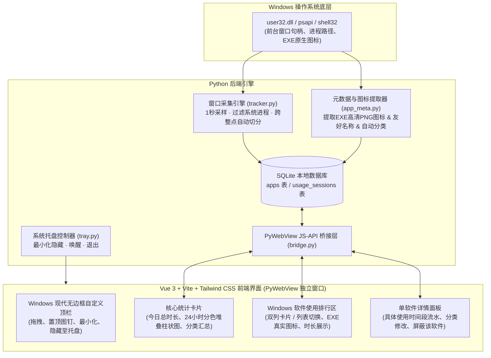

# Dayflow — Windows 桌面软件使用时间追踪工具设计方案

- **日期**：2026-10-29
- **状态**：已确认 (Approved)
- **技术栈**：Python 3 + PyWebView (Edge WebView2) + Win32 API + SQLite + **Vue 3 + Vite + Tailwind CSS**

---

## 1. 项目意图与背景 (Intent & Why)

我们需要开发一款专门运行于 **Windows 系统** 的原生感桌面软件使用时间统计工具（**Dayflow**）。

它的核心定位是：**平时静默挂在后台或最小化运行，无感记录用户每个时间段实际正在使用的 Windows 桌面软件；当用户点开窗口查看时，呈现一个类似参考图1（小智桌面）的 Windows 现代深色无边框圆角窗口，数据统计区参考图2的高效信息布局，丝滑展示今日总时长、24 小时分时段彩色堆叠柱状图、分类汇总以及带 Windows 软件真实图标的使用排行与时段明细。**

---

## 2. 目标、非目标与反目标 (Goals, Non-Goals, Anti-Goals)

### 2.1 目标 (Goals)
1. **后台无感运行与独立深色窗口**：支持最小化或隐藏至 Windows 系统托盘后台持续计时；点开时为独立深色圆角窗口，支持一键置顶固定在桌面或随时收起。
2. **精准的前台实际使用计时（不叠加）**：按“当前正在使用哪个软件（前台激活窗口）就算哪个软件”的原则计时，多个软件同时开启时只计入当前活动窗口，保证任意 1 小时内各软件时长之和不超过 60 分钟，且各软件时长总和与顶部总时长完全一致。
3. **只统计有界面的普通软件，自动过滤系统底层**：自动过滤 Windows 底层系统服务、宿主进程、锁屏界面及纯桌面空闲状态。
4. **自动提取软件真实图标与友好名称**：从 `.exe` 文件直接提取高清透明图标与软件中文/友好名称（如将 `WeChat.exe` 显示为“微信”并配原生绿底气泡图标）。
5. **分色分类统计与自定义分类**：内置常见 Windows 软件分类词典（社交通讯、开发与创意、影音娱乐、办公与浏览器、其他），渲染 24 小时分色堆叠柱状图，并支持用户在界面上随时修改任意软件的分类。
6. **历史回溯与时间段明细**：支持切换查看历史日期（昨天、过去 7 天等），并支持点击某个软件查看它在当天具体是哪几个时间段（如 `14:10 - 14:52`）被使用的。

### 2.2 非目标 (Non-Goals)
1. **不做云端同步与账号登录**：所有数据 100% 存储在本地 SQLite 数据库中，开箱即用，无隐私外泄风险。
2. **不做强制防沉迷锁机**：专注于时间记录与复盘展示，不拦截或强行关闭用户软件。
3. **不做浏览器插件级的二级网址拆分**：首期按操作系统进程粒度统计（如 Chrome、Edge 计为独立软件，同时在明细中保留当时的窗口标题供参考）。

### 2.3 反目标 (Anti-Goals — 出现即视为设计失败)
1. **做成手机模拟器外观或传统老旧灰白窗口**：注意这是一款 **Windows 桌面系统软件**（整体窗口气质应如参考图1“小智桌面”式的现代 Windows 11 深色桌面面板），仅数据图表卡片排布参考图2的“总时长+24小时柱状图+双列应用列表”，绝不能画成手机屏幕或带手机状态栏，更不能做成传统生硬的灰白 WinForms 窗口。
2. **系统进程污染排行列表**：排行榜里绝不能出现 `svchost.exe`、`SearchHost.exe`、`conhost.exe` 等系统底层组件。
3. **时长统计出现逻辑矛盾**：例如单小时柱子突破 60 分钟上限，或底部各软件时长加起来与顶部总时长对不上。

---

## 3. 运行与环境约束 (Constraints)

- **操作系统**：Windows 10 / Windows 11（利用系统自带的 Microsoft Edge WebView2 运行时渲染界面）。
- **性能要求**：后台采集采样频率为 `1 秒/次`，后台静默运行时 CPU 占用率需 `< 0.5%`，通过内存缓冲合并写入减少磁盘读写。

---

## 4. 技术方案选型与权衡 (Approaches)

### 4.1 桌面端整体技术方案对比

在沟通中我们对比了以下三种基于 Python / Java 的实现方案，并最终选定了 **方案 B**：

| 方案 | 技术组合 | 优势 | 权衡与取舍 | 结论 |
| :--- | :--- | :--- | :--- | :--- |
| **方案 A** | Python + PySide6 (Qt6) | 纯 Python 代码、后台内存占用最低（~40MB） | Qt 原生控件还原苹果毛玻璃、圆角堆叠柱状图和弹簧过渡动画开发成本较高 | 未采用 |
| **方案 B** | **Python + PyWebView + 现代前端框架 (Vue 3 / React)** | **Python 调 Win32 API 抓窗口/提图标最稳；现代组件化前端实现 iOS 丝滑动画与响应式状态管理体验最佳** | 包含 `backend/` (Python) + `frontend/` (Node/Vite) 前后端工程化分层 | **已选定** |
| **方案 C** | Java + JavaFX + JNA | 强类型工程结构 | JNA 提取 Windows 高清透明图标繁琐，JVM 常驻后台内存偏大（150MB+） | 未采用 |

### 4.2 前端框架子选型（Vue.js vs React vs Next.js）

针对 `PyWebView` 本地桌面窗口场景，对三个候选前端框架评估如下：

| 前端框架 | 适配度评估 | 结论 |
| :--- | :--- | :--- |
| **Vue 3 + Vite + Tailwind CSS** | **最佳推荐**：单文件组件 (`.vue`) 结构清晰，内置 `<Transition>` / `<TransitionGroup>` 动画与响应式数据流，非常适合高频实时刷新的计时面板；通过 Vite 打包为纯静态 `dist/` 目录，PyWebView 直接秒开，无需在后台额外挂 Node.js 服务器。 | **主推方案** |
| **React 18 + Vite + Framer Motion** | **同等优秀备选**：配合 `Framer Motion` 可实现极具弹性的 iOS 物理弹簧动画，同样通过 Vite 打包为纯静态资源供 PyWebView 加载。 | **备选方案** |
| **Next.js** | **不建议用于本桌面端场景**：Next.js 核心优势在于服务端渲染 (SSR) 与多页面 SEO，在本地单窗口桌面应用中引入 Next.js 会增加无谓的服务端运行时开销或静态导出限制，不如 Vite + Vue/React 纯粹轻快。 | 排除 |

---

## 5. 系统架构与核心设计 (Detailed Design)

### 5.1 整体架构图

### 5.2 核心模块一：Windows 前台窗口采集与过滤规则（用户确认 + 架构师决策）
1. **采样机制**：后台独立守护线程每 `1.0 秒` 调用一次 `win32gui.GetForegroundWindow()` 获取当前最前端激活窗口句柄 `hwnd`。
2. **有界面普通软件过滤漏斗**：
   - **可见性检查**：`win32gui.IsWindowVisible(hwnd)` 必须为真，且窗口标题或进程有效。
   - **锁屏与空闲桌面剔除（架构师决策）**：当检测到前台进程为 `LockApp.exe`、`LogonUI.exe`（Windows 锁屏界面）或桌面空闲（`explorer.exe` 且窗口类名为 `Progman` / `WorkerW` / `Shell_TrayWnd`）时，视为当前未操作任何具体应用软件，暂停计入应用时长（注：文件资源管理器正常打开文件夹窗口 browsing 时，窗口类名为 `CabinetWClass`，正常计入“文件资源管理器”）。
   - **系统底层黑名单剔除**：内置系统底层进程过滤黑名单（如 `SearchHost.exe`、`StartMenuExperienceHost.exe`、`ShellExperienceHost.exe`、`TextInputHost.exe`、`SystemSettings.exe`、`Taskmgr.exe`、`conhost.exe` 等），同时默认过滤掉 `Dayflow` 自身窗口（可在设置中开关），防止用户查看统计面板时把时间算到统计工具头上。
   - **UWP 应用穿透（架构师决策）**：若前台窗口进程为 `ApplicationFrameHost.exe`，自动枚举其子窗口找到真实承载的 UWP 进程（如微软商店版微信、系统画图等）。

### 5.3 核心模块二：会话合并与“跨整点切分”存储策略（架构师决策）
为了同时满足**“查看哪个时间用了哪个软件”**和**“秒出 24 小时柱状图且每小时绝不超过 60 分钟”**：
- 内存中维护当前正在进行的会话 `active_session`。只要用户没有切换软件，每秒只累加内存中的 `duration_sec`，每隔 10 秒（或在用户切换到其他软件、或打开统计界面刷新的瞬间）将最新时长同步更新到 SQLite 的当前行，极大降低磁盘 I/O。
- **跨整点自动切分**：当时间跨越整点（例如从 `13:59:59` 进入 `14:00:00`），采集器自动结束 `13` 时的会话记录，并在 `14` 时开启一条新会话记录。这样每条记录都严格归属于某一天（`date_str`）的某一个小时桶（`hour_bucket: 0~23`），前端渲染 24 小时堆叠柱状图时只需一次简单的 `GROUP BY hour_bucket, category` 即可精确绘出，永远不会出现某个小时柱子超过 60 分钟的情况。

### 5.4 核心模块三：图标提取与软件分类引擎
1. **高清图标提取**：首次捕获某软件 `.exe` 路径时，通过 Win32 API（`SHGetFileInfoW` / `ExtractIconEx` 配合 `win32ui` 位图转换）提取原生透明背景图标并保存为本地 `data/icons/<hash>.png`，供前端直接展示。
2. **软件名称美化**：优先读取 `.exe` 文件头部的版本资源信息（`FileDescription` 或 `ProductName`），并结合内置常用软件名称美化表（例如将 `WeChat.exe` -> `微信`，`Code.exe` -> `VS Code`，`chrome.exe` -> `Chrome`）。
3. **自动分类与配色（对标 iOS 屏幕使用时间）**：
   - **社交 (`social` · 苹果蓝 `#0A84FF`)**：微信、QQ、TIM、钉钉、飞书、Telegram、Discord 等
   - **创意与开发 (`creative` · 青色 `#5AC8FA`)**：VS Code、IDEA、PyCharm、Cursor、Photoshop、Premiere、Figma、CAD 等
   - **娱乐 (`entertainment` · 橙色 `#FF9F0A`)**：抖音、红果短剧、哔哩哔哩、网易云音乐、QQ音乐、PotPlayer、Steam、各类游戏等
   - **办公与效率 (`productivity` · 绿色 `#30D158`)**：Chrome、Edge、WPS、Word、Excel、PowerPoint、Notion、Obsidian、XMind 等
   - **其他 (`other` · 灰紫色 `#8E8E93`)**：未命中规则的软件默认归入此类，用户在界面上点一下即可改分类并永久生效。

### 5.5 核心模块四：数据库表结构 (SQLite)

1. **`apps`（软件元数据表）**
   - `id`: INTEGER PRIMARY KEY
   - `exe_path`: TEXT UNIQUE（进程完整路径或唯一标识）
   - `exe_name`: TEXT（如 `WeChat.exe`）
   - `display_name`: TEXT（如 `微信`，支持用户自定义重命名）
   - `category`: TEXT（`social` | `creative` | `entertainment` | `productivity` | `other`）
   - `icon_base64`: TEXT（缓存的 PNG 图标 Data URL）
   - `is_ignored`: INTEGER DEFAULT 0（支持用户手动屏蔽不想看到的工具软件）

2. **`usage_sessions`（使用时间段流水表）**
   - `id`: INTEGER PRIMARY KEY
   - `app_id`: INTEGER REFERENCES apps(id)
   - `date_str`: TEXT（格式 `YYYY-MM-DD`，建立索引）
   - `hour_bucket`: INTEGER（`0` ~ `23`）
   - `start_time`: TEXT（精确开始时间 `HH:MM:SS`）
   - `end_time`: TEXT（精确结束时间 `HH:MM:SS`）
   - `duration_sec`: INTEGER（持续秒数）
   - `last_window_title`: TEXT（记录当时的窗口标题摘要）

### 5.6 核心模块五：工程化前端界面与组件设计 (`frontend/`)
- **前端工程架构（Vue 3 + Vite + Tailwind CSS + Lucide Icons）**：
  - 开发模式下支持 Vite HMR 热更新，构建模式下生成静态产物由 Python `PyWebView` 本地加载（零 Node.js 后台进程残留）。
  - **视觉定位：纯正 Windows 现代深色桌面工具（参考图1“小智桌面”窗口外壳 + 参考图2的数据看板结构）**：
    - 窗口采用 Windows 11 深色暗夜灰材质（背景 `#18181B`、卡片 `#222226`、微光细边框 `rgba(255,255,255,0.07)`、字体优先 `Microsoft YaHei UI` / `Segoe UI`），右上角配备标准桌面工具的“图钉置顶”、“最小化”、“关闭至托盘”图标按钮与顶部胶囊导航。
    - 内部数据图表借鉴图2的高密度直观呈现方式（大字总时长 + 24小时分色堆叠柱状图 + 分类汇总 + 双列应用图标网格），但完全遵循 Windows 桌面交互习惯（悬停高亮、桌面级滚动条、丝滑弹窗/抽屉）。
  - 核心 Vue 3 组件划分：
    - `TitleBar.vue`：Windows 现代无边框窗口自定义顶栏（支持鼠标拖拽移动窗口、顶部导航标签、置顶图钉高亮状态、最小化、隐藏至托盘）。
    - `ScreenTimeCard.vue`：核心统计大卡片，包含今日累计总时长（带数字过渡动画）、日期切换器（`< 今日 >` 及近 7 天）、**24 小时分色堆叠柱状图组件 (`HourlyBarChart.vue`)** 及分类时长汇总栏。
    - `AppUsageGrid.vue`：Windows 软件使用排行区，支持**参考图2同款双列磁贴视图**与**单列进度条排行视图**丝滑切换。
    - `AppDetailModal.vue`：软件使用明细面板，展示单软件当天具体使用时间段流水（如 `09:15 - 10:02 · 47分钟` 及当时的窗口标题）、分类一键修改器及屏蔽开关。
- **窗口形态（复刻参考图1）**：
  - 独立窗口默认尺寸 `420 × 740 px`，深色高质感背景（`#121214`），顶部集成自定义无边框控制栏：左侧为应用 Logo 与日期切换器（`< 今日 >`、支持点选过去 7 天），右侧为 **“置顶图钉按钮”**、**“最小化按钮”**、**“隐藏到托盘关闭按钮”**。
- **数据看板（复刻参考图2 iOS 屏幕使用时间）**：
  1. **总时长与 24 小时柱状图大卡片**：
     - 顶部超大字号显示当天累计使用总时长（如 `18小时 57分钟`），相比昨日的变化百分比提示。
     - 中部为 **24 小时分色堆叠柱状图**：虚线网格背景，横轴标注 `0时`、`6时`、`12时`、`18时`，纵轴右侧标注 `0`、`30分`、`1小时`。每根柱子由该小时内不同类别的软件时长按颜色堆叠而成，鼠标悬停在某根柱子上时，丝滑浮现该小时的具体软件用时气泡。
     - 柱状图正下方横向排列各大分类（社交、创意、娱乐、办公）的彩色标题与各自累计时长。
  2. **软件排行区（支持“双列磁贴”与“单列排行”一键切换）**：
     - 默认采用**参考图2同款双列网格视图**（左侧高清圆角软件图标，右侧上方白色软件名、下方灰色时长如 `4小时`、`2小时43分钟`）。
     - 也可切换为带彩色进度条的单列排行榜。
  3. **点击任意软件弹出丝滑详情抽屉 (Bottom Sheet)**：
     - 展示该软件当天的**使用时间段流水时间轴**（例如：`09:15 - 10:02 (47分钟)`、`14:20 - 15:10 (50分钟)`，满足“查看哪个时间使用了哪个软件”的需求）。
     - 提供分类标签选择器（点击即可将该软件改为“社交 / 创意 / 娱乐 / 办公 / 其他”），以及“不再统计此软件”开关。

---

## 6. 留给开发阶段的细节 (What's Left to the Builder)

- 前端动画曲线的具体 CSS 参数（采用 `cubic-bezier(0.22, 1, 0.36, 1)` 还原苹果 iOS 阻尼感）与图表渲染具体代码。
- 常见 Windows 软件中文名称与默认分类词典的具体条目扩充（首期内置 60+ 款国内高频软件规则）。
- 连续短碎片会话合并优化（例如用户在同一个软件内 2 秒内闪烁切出又切回，自动合并为同一段连续记录，让时间段流水更干净易读）。
